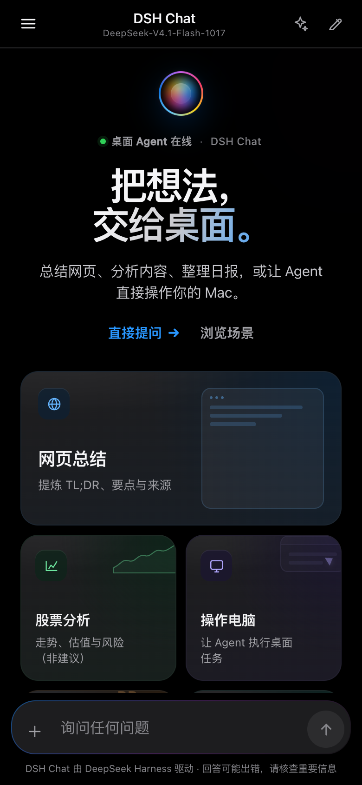
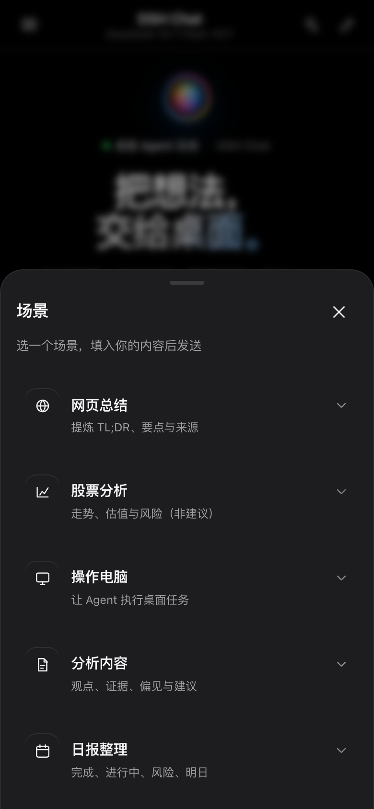
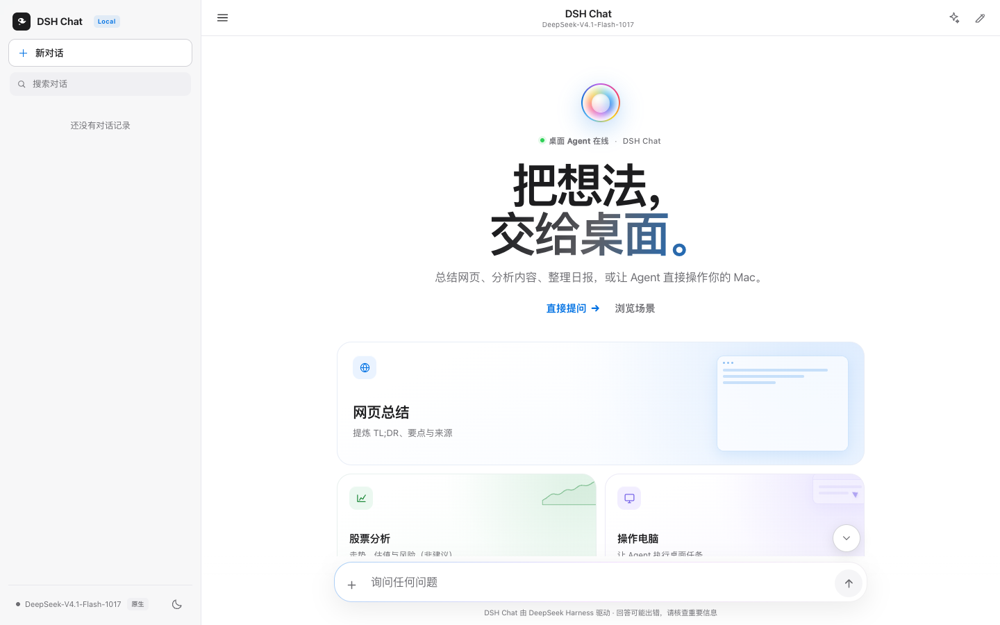
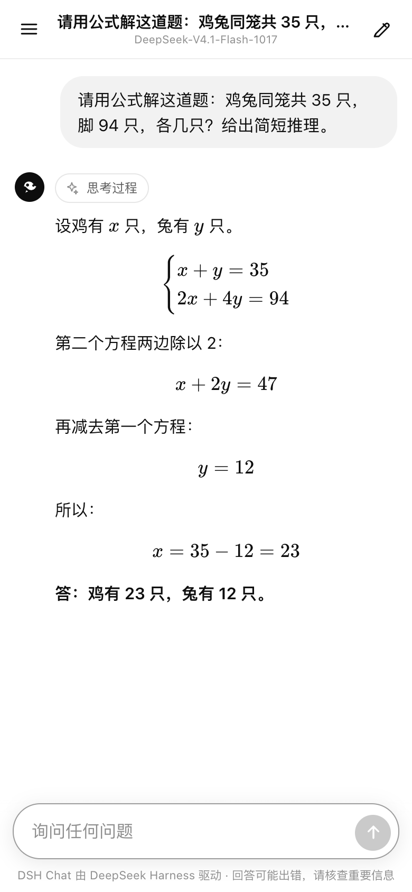
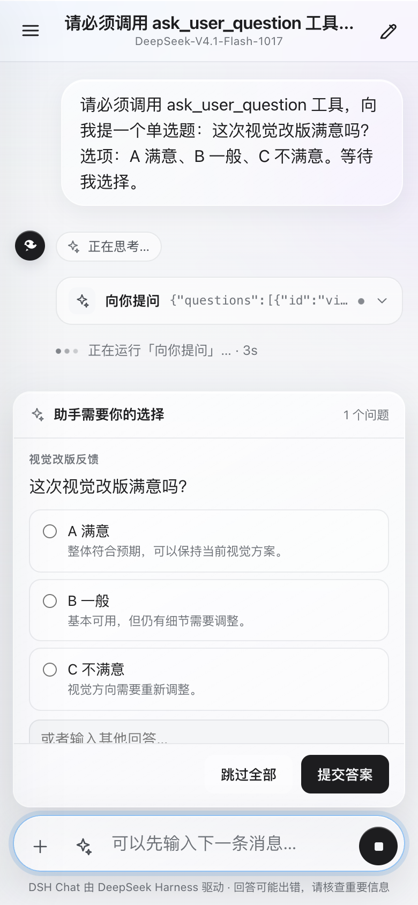
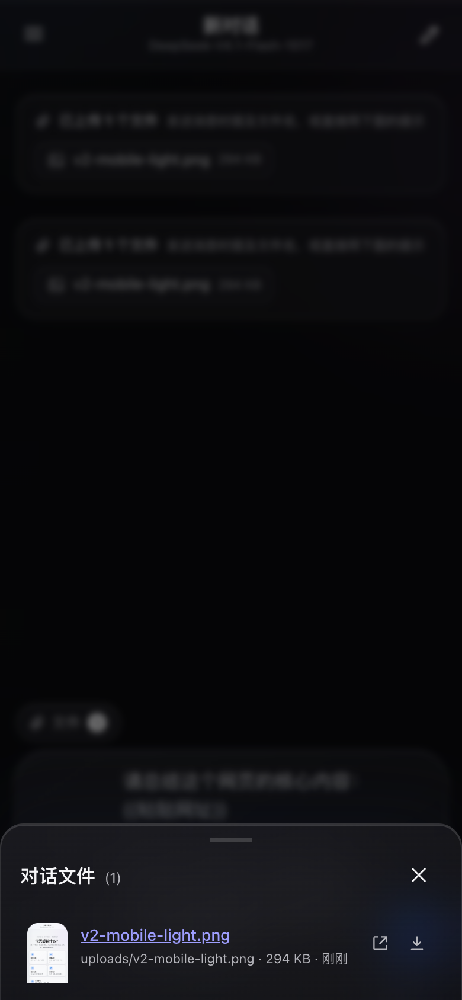
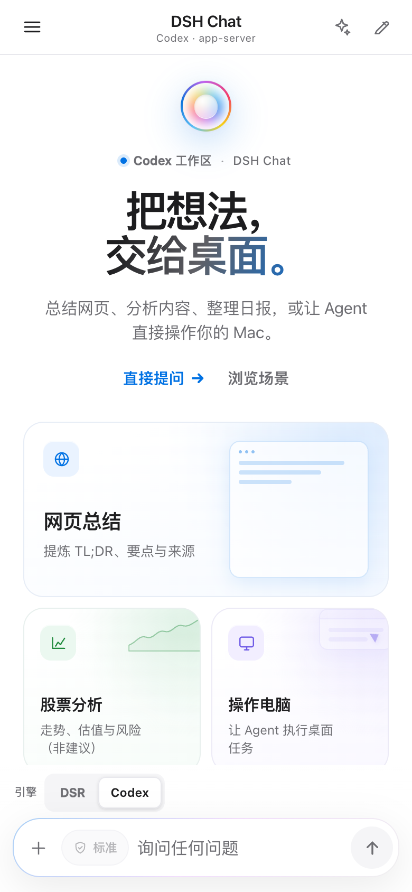
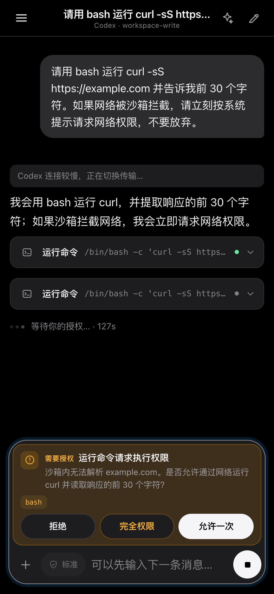
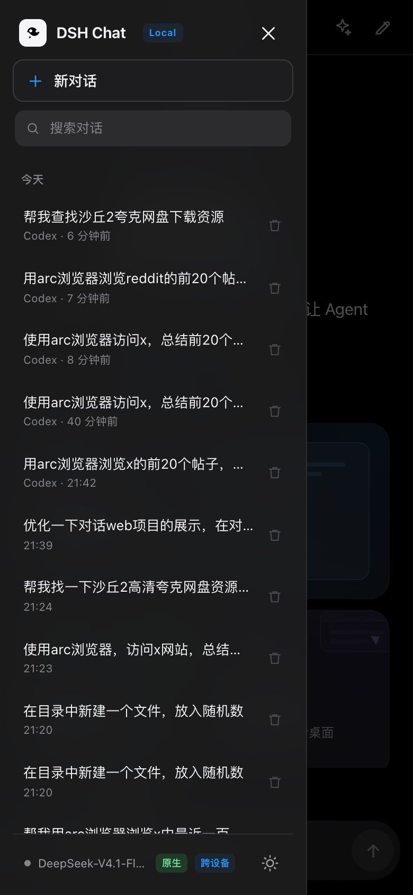

# DSH Chat

一个模仿 ChatGPT 移动端的内网聊天网站。打开网页输入问题后，服务端会启动 **DeepSeek Harness** 的 headless 模式处理对话，并把推理过程、工具调用和最终回答实时流式返回；工具调用（运行命令、读写文件、搜索等）会以可展开卡片展示。



## v4 视觉对齐升级（2026-10-22）

以 Apple 前端工程师视角完成 50 条展示/布局需求，分 5 轮闭环。重点不是换风格，而是把“对齐”变成系统：

- **一套栅格**：手机 14px、桌面 20px + 760px 阅读列；输入框、消息、场景卡同轨。
- **顶栏稳定**：320/390/768/1024/1440 五档标题中心与操作区无重叠；320 长标题安全截断。
- **输入区**：helper text 移出胶囊；权限/斜杠/Toast/批量条/查找条按真实 composer 高度避让。
- **桌面首页**：3 列 bento，5 个场景入口 + 提示在 1440×900 首屏内。
- **弹层系统**：设置等分、快捷切换居中、文件预览按钮等高、Prompt/收藏/归档同轨。
- **触控**：320/390 可见控件 <44px = 0；分离桌面紧凑密度与手机热区。

产品文档：`docs/product/visual-v4/`（总 PRD、五轮验收、QA、用户复验、50 条追踪矩阵）。
截图：`docs/visual-v4/`。

## v3 体验升级（2026-10-22）

本轮以 Apple 工程师视角完成 50 条体验需求、5 轮「试用 → PRD → 实现 → QA → 验收」闭环，重点补齐日常使用的可控感：

- **找得回**：会话全文搜索（标题 + 正文 + 摘要高亮）、置顶、重命名、分页、删除 8 秒撤销。
- **改得了**：重新生成、编辑重发、停止后继续、复制提问/回答/工具结果、导出 Markdown、token 用量浮层。
- **不丢东西**：按会话草稿、拖拽/粘贴附件、暂存区、上传进度、断网「待发送」、失败重试。
- **更顺手**：`⌘K` 命令面板、`⌘F` 全文搜索、`⌘⇧K` 新对话、`?` 快捷键面板、`/` 斜杠命令。
- **更像原生**：三态主题、文件预览（文本/图片/PDF）、PWA manifest、Apple touch icon、App Badge、完成通知。
- **更稳**：44px 触控、焦点陷阱、Reduce Motion/Transparency、对比度 ≥4.5:1、gzip/ETag、原子写并发修复。

产品文档：`docs/product/v3/`（总 PRD、5 轮验收、QA 报告、用户复验、发布说明、50 条追踪矩阵）。

## 快速访问

服务已注册为 macOS 登录服务（launchd），开机自启、崩溃自动拉起。

| 项目 | 值 |
| --- | --- |
| 本机地址 | <http://127.0.0.1:8787> |
| 内网地址 | <http://192.168.31.227:8787> |
| 访问码 | 见 `config.json` 的 `accessCode` |

查看访问码：

```bash
cd ~/Code/DS/dsh-chat
python3 -c "import json;print(json.load(open('config.json'))['accessCode'])"
```

同一 WiFi / 内网下的手机、电脑直接打开内网地址，输入访问码即可使用。当前机器还接入了 Tailscale，也可以用 `http://100.85.136.30:8787` 从 Tailscale 网络访问。

## 功能

- **ChatGPT 风格移动端界面**：顶部栏、抽屉式会话列表、气泡消息、固定在底部的圆角输入框、浅色/深色主题。
- **编辑式 Apple 首页**：渐变 orb、双行大标题、双 CTA；场景改为 1 大 + 4 小的 bento 卡片，带浅色 tint 与 CSS 小插画。
- **轻量材质**：白/浅灰底、大留白、细边框、克制阴影；液态玻璃只保留在顶栏、侧栏与弹层，支持 Reduce Motion / Reduce Transparency 降级。
- **场景中心**：网页总结、股票分析、操作电脑、分析内容、日报整理五个场景，一键填入模板并选中占位符。
- **文件上传**：`+` 上传（≤25MB、最多 5 个），自动创建工作区并把文件加入对话文件抽屉。
- **原生会话（推荐）**：网页端通过本机桥接，直接在 DeepSeek Harness 桌面版宿主里创建会话、挂载「标准模式」预设，网页与桌面版共享同一份会话列表、工具和模型。
- **Headless 兜底**：桌面版未运行或桥接未启用时，自动退回 `dsh --profile headless --json`，网页仍可正常聊天。
- **Token 级流式**：原生模式下正文与思考逐字增量输出；工具调用/结果为提交点更新。headless 兜底为提交级流式。
- **后台任务**：关闭页面、锁屏或切换对话不会终止生成；服务端继续执行并持久化，回来自动续接。
- **流式输出**：思考过程、工具调用、工具结果、正文和 token 用量边生成边显示。
- **工具调用可视化**：`bash`、`write`、`read`、`edit`、`grep`、`web_search` 等以卡片展示，点开可看参数与完整结果。
- **文件产出与下载**：每轮新增或修改的文件自动出现在回答下方；输入框上方的「文件 N」打开对话文件抽屉，支持在线查看与下载。
- **Agent 提问 / 审批**：`ask_user_question` 在输入框上方渲染选项卡片，支持单选、多选、自定义回答和跳过；工具审批直接内嵌在输入框内，显示工具名与原因，可点选「允许一次 / 完全权限 / 拒绝」。已选择过的卡片在刷新或重新打开网页时不会再次弹出。
- **对话级权限选择**：输入框内新增权限胶囊，可随时在只读 / 标准 / 完全权限之间切换；完全权限会跳过后续授权确认，状态按对话持久化并同步到桌面版宿主。
- **Markdown 渲染**：标题、列表、表格、引用、代码块（带复制按钮），纯本地实现，无 CDN 依赖。
- **数学公式**：本地内置 KaTeX，支持 `\(...\)`、`\[...\]`、`$$...$$` 公式排版。
- **会话管理**：自动命名、历史列表、删除、刷新后继续；生成中可以随时停止。
- **单用户跨设备共享**：所有登录设备看到同一份会话列表；在手机上可以继续电脑上的对话，运行中的任务也能在另一台设备 attach 续接。
- **访问码保护**：所有 API 需要登录；登录失败有频率限制。
- **会话独立工作区**：每个会话在 `data/workspaces/<会话ID>` 下运行 Agent，互不覆盖。
- **会话深链与消息链接**：`/c/<id>` 可直接打开对话，`#m-<id>` 定位到具体消息。
- **收藏 / 提示词 / 总结**：消息星标、提示词库、结构化总结（见 v3 章节）。
- **归档 / 批量 / 快速切换**：归档箱、批量管理、⌘P 快速切换。
- **文件抽屉操作**：上传、预览、插入路径、删除。
- **离线可开**：Service Worker 缓存 shell，断网仍能查看已缓存会话。

## v3 体验增强（2026-10）

五轮「用户试用 → 50 条需求 → PRD → 研发 → 测试 → 验收」的落地结果，详见 [`docs/product/final-report.md`](docs/product/final-report.md) 与 `docs/product/cycles/`。

- **定位与恢复**：会话深链 `/c/<id>`、消息锚点 `#m-<id>`、浏览器前进/后退；会话内查找（⌘/Ctrl+F）带命中计数与上下跳转；每会话滚动位置恢复；日期分隔。
- **组织**：归档箱、批量归档/删除、批量撤销、⌘P 快速切换、对话统计、创建副本（含工作区文件）。
- **沉淀**：消息收藏与收藏面板、提示词库（默认周报/代码审查/会议纪要）、一键结构化总结（二次确认并提示成本）。
- **输入与文件**：草稿按会话保存、拖拽/粘贴附件、上传进度与取消、附件随消息持久化；文件抽屉内上传、预览、插入路径、删除。
- **设置**：跟随系统/浅色/深色、阅读密度、正文字号、完成通知、全部已读、存储占用、备份导出/导入。
- **性能**：6 个 CSS 合并为 `/css/bundle.css`（1 请求，gzip ~29KB）；KaTeX 仅在出现公式时加载；长对话默认渲染最近 60 条。
- **离线与更新**：Service Worker 缓存 shell 与静态资源，断网可打开已缓存会话；新版本就绪时 Toast 提示刷新。
- **可访问性**：焦点陷阱、44px 触控目标、Alt+↑/↓ 消息导航、高对比度、打印样式、320px 适配。

### 测试

```bash
export ACCESS_CODE=$(python3 -c "import json;print(json.load(open('config.json'))['accessCode'])")
node tools/qa/e2e.mjs      # 29 项：会话/消息/附件/断网/无障碍基础
node tools/qa/e2e2.mjs     # 17 项：深链/查找/归档/批量/设置/统计/副本
node tools/qa/e2e3.mjs     # 8 项：收藏/提示词/进度/未读/查找分享
node tools/qa/e2e5.mjs     # 6 项：文件增删/导入/全部已读
node tools/qa/api.mjs      # 23 项接口合同
node tools/qa/offline.mjs  # 5 项断网恢复
node tools/qa/a11y.mjs     # 对比度 + 焦点陷阱
```

> 需要本机 headless Chrome 开启 `--remote-debugging-port=9222`；Node 可用 Desktop 内置运行时。

### 已知限制

- 导入备份只创建新会话（标题加 `[导入]`），不去重；不包含工作区文件。
- 收藏、提示词、阅读偏好是设备级（localStorage），不跨设备同步。
- 文件删除不可撤销（有二次确认）。
- 长对话窗口化后，会话内查找只覆盖最近已渲染的 60 条。
- `app.js` 仍为单文件（约 230KB，gzip ~55KB），暂无构建链。
- 打印样式未在 Safari 实机验证；VoiceOver 全流程未脚本化；通知需浏览器授权，iOS 需先安装 PWA。

## 界面预览

| 场景中心 | 桌面端 |
| --- | --- |
|  |  |



| Agent 提问 | 对话文件抽屉 |
| --- | --- |
|  |  |


## 后台任务与续接

- 每次回复在服务端有独立的运行实例；浏览器连接只是其中一个订阅者。页面关闭/刷新/手机锁屏只会断开订阅，**不会停止任务**。
- 正在生成的对话在侧栏显示「正在生成…」。重新打开该对话时，网页会自动 attach 到运行实例：先补发已有事件（reset + 回放），再继续接收增量。
- 手机锁屏/退出网页后再次进入：先用 localStorage 缓存渲染上一次会话与可见输出，再静默重试 `/api/me`、会话列表和 attach；期间只显示顶部「正在重新连接…」小条，不会弹 `Load failed`。网络恢复后自动同步。
- 切换对话或点「新对话」只是 detach，不会停止原任务；只有点「停止」才会显式停止。
- 部分内容会持续写入 `data/conversations.json`；即使任务在你离开期间完成，回来也能看到完整结果。
- 服务重启会丢失内存中的运行实例，正在生成的对话会标记为中断；这是当前唯一会终止后台任务的服务器侧操作。
- 单条任务最长运行时间仍由 `maxRunMinutes` 限制（默认 30 分钟）。

## 双引擎：DSR / Codex

- 新建对话的输入框上方有 `DSR | Codex` 切换；首条消息发出后锁定，避免中途换引擎导致上下文错位。
- **DSR**：桌面版原生桥接优先，headless CLI 兜底；支持 token 级流式、提问卡、网页授权卡、对话级权限切换和桌面版会话同步。
- **Codex**：对接 Codex Desktop 的 **app-server**（`codex app-server`，同一 `CODEX_HOME`）；使用 `thread/start`、`turn/start`、token 级 delta、命令/文件事件、usage 和 `thread/resume` 续聊。
- **Codex 模型与思考强度**：Codex 对话可以选择模型（GPT-6.1-Sol / GPT-6-Astra / GPT-5.6 系列等）和思考强度（低 / 中 / 高 / 很高 / 最高 / Ultra）。模型目录来自 app-server 的 `model/list`，按模型显示其真正支持的强度；选择在**下一条消息**生效，并按对话持久化。
- **在 Codex 桌面端打开**：Codex 对话的顶栏和模型菜单里都有「在 Codex 中打开」。点击后通过 `codex://threads/<id>` 直接打开完整对话；重命名会同步到 Codex 侧栏标题。
- **长连接 app-server**：整个网页服务只保留一个热的 `codex app-server` 进程，多段对话复用；不会每条消息重新启动进程、重新初始化。
- **HTTPS 传输优化**：自动注册一个只走 HTTPS 的 Codex provider（`openai_https`），跳过 Responses WebSocket 的 5 次 15 秒超时重试；首条消息从约 2 分钟降到约 5 秒。
- Codex 也支持手机网页的 **授权卡**（拒绝/允许一次/本次会话）和 **提问卡**（`request_user_input`）。授权决定写回 app-server 的 server request。

- **Computer Use 按应用授权**：Codex Computer Use 请求使用 Arc 等应用时，会通过 `mcpServer/elicitation/request` 到达网页授权卡；点“允许一次/完全权限”后才会继续控制该应用。macOS 的辅助功能/屏幕录制权限仍由 Codex Computer Use 负责。
- **Codex 权限等级**：新对话或会话中可选择 **只读 / 标准 / 完全权限**，映射为 app-server 的 `sandbox`：
  - 只读 → `read-only`，标准 → `workspace-write`，两者 `approvalPolicy=on-request`，敏感操作会弹网页授权卡。
  - 完全权限 → `danger-full-access` + `approvalPolicy=never`，不再请求沙箱授权；Computer Use 使用应用的授权仍会单独询问。
  - 权限修改对 Codex 的**下一条消息**生效，不会热改正在执行的 turn。
- Codex thread 写入 Codex 的 rollout store（`~/.codex/sessions`）和 `state_5.sqlite` 索引。网页新建的 thread 会记录 `originator=dsh-chat` 和 `model_provider=openai_https`，因此：
  - 点「在 Codex 中打开」可立即在 Codex 桌面端查看完整对话（包括桌面端重启前）。
  - 重启 Codex 桌面端后，这些对话会出现在「最近」侧栏，标题与网页一致。
  - 桌面端继续对话时，使用的是同一个 thread store；网页再次打开该 conversation 仍会通过 `thread/resume` 续聊。
- 首次启动本服务时会向 `~/.codex/config.toml` 追加 `[model_providers.openai_https]`（原文件备份为 `config.toml.dsh-backup`）。这一节只供 Codex 识别网页 thread，不改变桌面端的默认 `model_provider`。**注册后需要重启一次 Codex 桌面端**，侧栏才会加载这些 thread。要回滚，删除这一节并重启 Codex 即可；不要删除 `config.toml.dsh-backup`，它是首次修改前的原始文件。
- Codex 二进制自动查找 Codex.app 内置路径，也可用 `CODEX_BIN` 指定；未找到时引擎按钮会禁用。

> 说明：这里的“对接 Codex Desktop”指使用 **app-server 协议 + 同一 `CODEX_HOME` / thread store**，不是附着到已经打开的 Codex Desktop 窗口。桌面 app-server 由 Electron 通过私有 stdio 持有，没有公开的本地 socket；网页启动的是独立 app-server 进程。网页 thread 会写入 Codex 的 rollout store 和 `state_5.sqlite`；桌面端启动时会读取这些索引。侧栏不会在外部进程新建 thread 时实时刷新，所以「在 Codex 中打开」是即时入口，重启桌面端后侧栏也会收录。



### Codex 模型与思考强度

- 新建 Codex 对话时，输入框上方的 `Codex` 引擎旁会出现模型胶囊（例如 `GPT-6.1-Sol · 低`）；首条消息发出后，胶囊移到输入框下方，随时可改。
- 点开后可选择：**模型**（含说明、默认标记）和**思考强度**（按该模型实际支持的档位显示）。选择会 PATCH 到当前对话，下一条消息生效，不会中断正在执行的 turn。
- 默认使用模型目录给出的默认强度；也可以把 `codexModel` / `codexEffort` 写进新对话的创建请求，或用 `PATCH /api/conversations/:id` 修改。
- 模型目录由 `GET /api/codex/models` 提供，来自本机 Codex，缓存于 `data/codex-models.json`。模型列表为空时会退回本机配置里的默认模型。
- 速度建议：日常问答选「低 / 中」，复杂任务再升到「高 / 很高」；`Ultra` 会启用自动任务委派，明显更慢。

### 打开 / 同步到 Codex 桌面端

- 顶栏的「在 Codex 中打开」按钮，或模型菜单底部的同名按钮，会调用 `POST /api/conversations/:id/open-codex`，由服务端执行 `open codex://threads/<threadId>`。
- 打开后，桌面端显示完整历史；在桌面端重命名、继续对话都使用同一个 Codex thread。
- 网页重命名会通过 `thread/name/set` 同步到桌面侧栏；新建 thread 后也会自动同步一次标题。
- 重启 Codex 桌面端（或关闭后重新打开窗口）后，网页新建的 Codex 对话会出现在「最近」列表。
- 目前是「同一 thread」而不是双向消息镜像：在桌面端继续产生的消息不会回写到网页的本地时间线；网页再次发消息仍会复用同一个 thread，因此模型上下文连续，但网页只显示网页侧的历史。需要完全双向时，可以后续加 `thread/read` 导入。




## 权限与授权

- 输入框内的「权限」胶囊可以在对话中随时切换权限等级，选项来自桌面版宿主的权限目录（默认：只读 / 标准 / 完全权限）。
  - **只读**：可以读取和搜索，但不能写入或修改。
  - **标准**：仅允许在工作区内写入；敏感操作会先弹出授权条。
  - **完全权限**：不受工作区限制，不再弹出授权确认，Agent 可以直接执行任意操作。只在你信任当前任务时使用。
- 权限按对话保存在服务端；切换会立即推送到桌面版中的原生会话，之后的消息继续沿用；新对话回到默认「标准」。
- 桌面版宿主通过 `approval/request` 请求授权；网页发起的运行（原生模式）由聊天桥接接管，直接渲染成输入框内的授权条。
- 授权条显示工具名、原因和三个选项：
  - **允许一次**：只对当前这一次工具调用生效。
  - **完全权限**：允许当前操作，并把当前对话切换为完全权限；后续不再询问。
  - **拒绝**：操作不执行，宿主以 fail-closed 继续。
- 选择后授权条会就地变成一行结果，随后自动收起；对话继续执行。
- 授权等待中刷新、锁屏或重新进入，未处理的授权条会随 attach 回放重新出现；**已经处理过的提问/授权会记录为已处理，不再重复弹出**。
- headless 兜底没有授权 UI；权限选择仍会保存，但没有原生宿主可应用。

## 流式输出

- 原生模式下，桌面版宿主会推送 token 级的 text/reasoning delta；网页用临时的 live 块实时渲染，提交后再用持久块替换，避免重复。
- 工具调用、工具结果、标题等仍以提交点为单位。
- headless 兜底模式没有 token 级接口，只能按提交块流式输出。
- 实时块最多 50ms 合并一次重绘，避免移动端高频 markdown 重排。

## 跨设备继续

- 同一访问码登录的手机 / 电脑共享同一份会话列表、文件、权限设置、提问与授权状态。
- 在电脑上发起、手机上打开同一会话：会自动 attach 到正在运行的任务，看到当前进度；刷新/切回页面会刷新列表。
- 每台设备只记住自己最后打开的会话（`localStorage`），不会强制把其他设备跳到同一个页面。
- 默认 `singleUser: true`；访问码是唯一边界，适合个人使用。多人共用请设 `singleUser: false`，但已经共享的数据不会自动按设备拆回去。
- 共享模式下，任何登录设备都可以停止任务、回答提问或批准授权；这是“换设备继续”的必然结果。



## 场景

空状态和输入框左侧的「✦」都能打开场景抽屉，点击后会把模板填进输入框并选中占位符，替换后发送即可。

| 场景 | 模板会做什么 | 适合 |
| --- | --- | --- |
| 网页总结 | 抓取网页 → TL;DR + 要点 + 追问 + 来源 | 看长文、做竞品调研 |
| 股票分析 | 走势、估值、风险、事件；标注来源与时间，不给投资建议 | 快速了解标的 |
| 操作电脑 | 先列步骤再执行；危险操作先确认 | 文件整理、命令执行 |
| 分析内容 | 观点、证据、偏见/遗漏、可执行建议 | 文档、文章、会议记录 |
| 日报整理 | 今日完成 / 进行中 / 风险 / 明日计划 | 下班前整理 |

> 场景只是高质量提示词入口；实际能力取决于桌面版注入的工具与权限。提问/审批卡只在原生模式下可用，headless 兜底不支持。

## 设计语言

- 编辑式首页：顶部渐变 orb + 状态点、两行大标题（第二行轻微渐变）、「直接提问 / 浏览场景」双 CTA；首屏只出现一个主视觉，避免堆叠。
- 场景区是 bento：网页总结横跨两列并配浏览器小插画；其余四张 2×2，各自带淡色 tint 和角落小插画（折线、窗口、引号、清单）。最后一张不再单独占满整行。
- 以白色/浅灰为主，大标题、大留白、细边框；场景卡是带 tint 的实体卡片，不再逐卡叠加模糊。
- 玻璃只保留在顶栏、侧栏和弹层；输入框是白色胶囊 + 细边框 + 轻阴影，工具卡/代码块用实色。
- 输入框单行高度固定 44px，空状态与输入后文字都垂直居中（修复了空输入时文字掉到底部的问题）。
- 明暗两套 token；正文对比度 ≥4.5:1，弱化文字浅色 `#686c72`、深色 `#b4b4ba`。
- 动效 `cubic-bezier(.22,1,.36,1)`，220–420ms；`prefers-reduced-motion` 关闭极光与过渡；`prefers-reduced-transparency` 或浏览器不支持 blur 时自动回退实体背景。
- 发送按钮 40px 黑色主按钮；`+` 留在输入框内，场景入口移到顶栏（✦），减少输入区干扰。
- 侧栏增加 Local 标签与当前会话蓝色细条；输入框使用细渐变描边，聚焦时出现蓝色光圈。
- 动效：orb 缓慢浮动、hero 分层上浮、bento 卡片依次淡入；全部遵循 `prefers-reduced-motion`。

## 工作原理

**原生模式（桌面版正在运行）**

```
浏览器（移动端 UI）
   │  POST /api/conversations/:id/chat  →  NDJSON 流
   ▼
Node.js 服务（server/index.mjs）
   │  JSON-RPC（127.0.0.1:47821，一次性令牌）
   ▼
dsh-chat-bridge（挂载在 DeepSeek Harness 桌面版宿主进程里）
   │  ctx.agents.create + 「standard」preset 工具挂载
   ▼
桌面版 Agent（同一套模型、工具、会话存储、工作区索引）
   │  session/event 事件流
   ▼
网页实时显示；桌面版侧栏同步出现「DSH Chat」工作区下的会话
```

- 所有网页会话都归入桌面版的一个 **「DSH Chat」工作区**，每个会话的实际工作目录是 `data/workspace/chats/<会话ID>`，文件互相隔离。
- 网页删除对话时，会同时把桌面版里的对应会话**归档**（历史保留、列表隐藏），并删除该会话的工作目录。
- 网页里的历史仍保存在 `data/conversations.json`；原生会话日志保存在 `~/.dsh/sessions/`。

### 文件与提问交互

- 每轮回答结束后会扫描会话工作区，新增或修改的文件以「本轮文件」卡片列在回答下方；输入框上方的「文件 N」打开对话文件抽屉，列出该会话的全部文件。
- 文件通过需要登录的接口读取，路径被限制在会话工作区内（含符号链接校验）。文本和图片可直接打开，HTML/SVG 等类型强制以下载方式返回，避免在本站执行脚本。
- 为了控制体积和隐私，隐藏文件/目录、`node_modules`、`.git`、虚拟环境等不会出现在列表中；Agent 写到工作区之外的文件也不会列出。
- Agent 调用 `ask_user_question`（以及使用同一通道的审批请求）时，网页会在输入框上方显示选项卡片：单选、多选、自定义文本、逐题跳过都支持。提交后答案回到原生 Agent，当前回合继续，不会新建对话。
- 已提交的提问与授权请求会同时在服务端事件流和浏览器本地记录；刷新、重开页面或 attach 回放时会被跳过，不会再次弹出。未处理的卡片仍会恢复，方便继续选择。
- 如果当前回合被停止或连接断开，未回答的问题卡片会显示「已失效」；headless 兜底模式没有提问 UI，Agent 的提问会直接返回不可用。

**Headless 兜底（桌面版未运行 / 未安装桥接）**

```
Node 服务 → spawn dsh --profile headless --json --session-id …
          → 解析 NDJSON 事件 → 网页
```

这种对话不会出现在桌面版；桌面版重启后，**新开的对话**会自动使用原生模式（已有对话保持原模式）。

启动时会读取桌面版 DSH 的 `~/.dsh/profiles/desktop/cordis.patch.yml`，同步当前的模型与 provider。在桌面版里切换模型后，重启本服务和桌面版即可生效。

## 部署与运维

### 启用原生集成（网页 ↔ 桌面版共享会话）

原生桥接是安装到 **DeepSeek Harness 桌面版 profile** 里的一个本地插件（只监听 `127.0.0.1`）。安装后桌面版通常会自动热加载，立即生效；如果侧栏没有变化，再完全退出并重新打开桌面版。

```bash
cd ~/Code/DS/dsh-chat

# 1. 安装桥接插件（会备份 ~/.dsh/profiles/desktop/cordis.patch.yml）
./deploy/install-native.sh

# 2. 通常桌面版会热加载 profile，立即生效；
#    若状态没变，完全退出并重新打开 DeepSeek Harness 桌面版
#    之后网页端会自动切换为原生模式，无需重启网页服务
```

验证是否生效：

```bash
tail -20 data/server.log
# 看到：原生桥接   已连接（网页与桌面版共享同一份会话列表）

tail -5 ~/.dsh/chat-bridge.log
# 看到：bridge: listening on 127.0.0.1:47821
```

然后在网页里**新开一个对话**，桌面版左侧「工作区」中会出现 **DSH Chat**，里面的会话标题与网页对话同步；在桌面版里打开它，可以继续同一段上下文。

卸载：

```bash
./deploy/uninstall-native.sh
# 再重启一次 DeepSeek Harness 桌面版；网页端回退 headless
```

> 注意：原生桥接加载失败不会影响网页服务的启动；只要桌面版重启成功，网页端会自动连上。若桌面版无法启动，用备份的 `cordis.patch.yml.bak-*` 恢复，或运行上面的卸载脚本后重启桌面版。

### 服务管理

```bash
cd ~/Code/DS/dsh-chat

# 安装 / 重启（已安装过会先卸载再装）
./deploy/install.sh

# 查看状态
launchctl print gui/$(id -u)/com.dshchat.server | head -20

# 查看日志
tail -f data/server.log

# 停止并移除自启
./deploy/uninstall.sh

# 前台临时运行（调试用）
./start.sh
```

`deploy/install.sh` 会生成 `~/Library/LaunchAgents/com.dshchat.server.plist`，使用 `KeepAlive` 和 `RunAtLoad`。日志写入 `data/server.log`。

### 配置 `config.json`

```json
{
  "host": "0.0.0.0",
  "port": 8787,
  "accessCode": "YOUR-ACCESS-CODE",
  "title": "DSH Chat",
  "maxRunMinutes": 30,
  "codexPrewarm": false,
  "dshHome": "~/.dsh",
  "desktopProfile": "desktop",
  "appBinary": "/Applications/DeepSeek Harness.app/Contents/MacOS/DeepSeek Harness"
}
```

| 字段 | 说明 |
| --- | --- |
| `host` / `port` | 监听地址与端口。`0.0.0.0` 表示允许内网访问 |
| `accessCode` | 访问码；改完重启服务后旧登录自动失效 |
| `maxRunMinutes` | 单条消息最长运行时间，超时会终止 Agent |
| `codexPrewarm` | 启动时是否额外跑一个极小的 Codex 预热 turn，默认 `false`。正常首条消息已由 HTTPS provider 加速，无需开启 |
| `singleUser` | 默认 `true`：所有登录设备共享同一份会话；`false` 恢复按浏览器隔离（新安装生效） |
| `nativeEnabled` | 是否启用桌面版原生桥接，默认 `true` |
| `nativePort` | 原生桥接监听端口，默认 `47821`（只监听 127.0.0.1） |
| `nativeWorkspaceTitle` | 桌面版侧栏显示的工作区名称，默认 `DSH Chat` |
| `dshHome` | DeepSeek Harness 数据目录，默认 `~/.dsh` |
| `desktopProfile` | 从哪个桌面 profile 复制模型配置 |
| `appBinary` | DeepSeek Harness 可执行文件路径（App 更新后通常不变） |

修改后重启：

```bash
launchctl kickstart -k gui/$(id -u)/com.dshchat.server
```

## 安全说明（重要）

- 这是一个**能操作本机文件的 Agent**。原生模式下，网页会话直接跑在桌面版宿主里，使用桌面版的「标准模式」工具与权限设置。拿到访问码的人可以让它执行命令、读写文件，请把访问码当作密码，不要发到公开群聊。
- 工具需要审批时，授权条直接出现在网页输入框里；等待期间如果无人操作，当前工具调用会一直等待。日常的工作区内读写通常不需要审批。
- 默认「标准」权限以 `workspace-write` 沙箱运行在每个会话自己的目录里；写入被限制在工作区，但读取范围可能更广。选择「完全权限」后不再受工作区限制，也不再弹出授权确认，**相当于把本机控制权交给当前对话**；不要在不可信任务或共享访问码的场景中开启。
- 会话内容以明文保存在 `data/conversations.json`；原生对话的工作区文件在 `data/workspace/chats/`，headless 对话在 `data/workspaces/`。删除会话会同时删除对应工作区。
- 文件下载需要登录，并经过工作区路径校验；但拿到访问码的人仍然可以读取该会话产出的所有文件。
- 默认是 HTTP，访问码在内网中以明文传输。对不可信网络建议走 Tailscale / 内网 VPN，或在前面加一层 HTTPS 反向代理。
- 默认开启单用户跨设备共享：**拿到访问码的任何设备都能看到全部会话、文件和权限设置**。请把访问码当作唯一密码；不要把访问码发给别人。若需要按浏览器隔离，把 `singleUser` 设为 `false`（新安装生效；已经迁移为共享 owner 的旧数据不会自动拆分）。

## 常见问题

**手机打不开，电脑能打开？**

首次监听时 macOS 可能弹出“是否允许接受传入网络连接”，选择“允许”。也可以到「系统设置 → 网络 → 防火墙 → 选项」确认允许 `DeepSeek Harness` 或 `node` 接收入站连接。

**Codex 首条消息还是慢？**

确认 `data/server.log` 里有 `Codex 桥接 已预热（N 个模型 …）`，并且 `~/.codex/config.toml` 已包含 `[model_providers.openai_https]`。正常首条消息约 5 秒；如果仍然走 WebSocket，可以临时用 `DSH_CODEX_WS=on` 回到原生传输，或检查网络是否拦截了 `wss://`。模型选 `Ultra` 时会明显更慢，日常用「低 / 中」。

**Codex 桌面端看不到网页对话？**

点 Codex 对话顶栏的「在 Codex 中打开」，会立即用 `codex://threads/<id>` 打开完整对话。希望它出现在「最近」侧栏时，重启一次 Codex 桌面端；桌面端启动时会重新读取 `state_5.sqlite` 索引和 `openai_https` provider。首次注册 provider 后也必须重启桌面端。

**页面显示“无法连接服务器”**

```bash
launchctl print gui/$(id -u)/com.dshchat.server | head
tail -30 data/server.log
```

**回答报 `MISSING_CREDENTIAL`**

说明 headless 进程没拿到模型凭据。打开 DeepSeek Harness 桌面版确认已登录/已配置模型，然后重启本服务。本服务会复用桌面版已保存的凭据。

**网页对话在桌面版哪里？**

安装原生桥接并生效后，打开桌面版左侧「工作区」，会看到一个名为 **DSH Chat** 的工作区；网页里的每个对话对应其中一条会话。它们的实际工作目录在 `dsh-chat/data/workspace/chats/<网页会话ID>/`。

**桌面版关掉后网页还能用吗？**

可以，但新对话会回退到 headless 模式（不会出现在桌面版里）。已经创建的**原生对话**在桌面版重新打开前无法继续，会提示桥接不可用。

**上传的文件会出现在哪里？**

上传后会写入当前对话工作区的 `uploads/`，在「文件 N」抽屉和本轮上传提示里都能看到；Agent 可以按相对路径读取。图片会在抽屉里显示缩略图。

**回答里提到的文件在哪里？**

原生对话在 `dsh-chat/data/workspace/chats/<网页会话ID>/`，headless 对话在 `dsh-chat/data/workspaces/<网页会话ID>/`。网页上点回答下方的文件卡片，或输入框上方的「文件 N」，可以直接打开或下载。

**为什么文件列表里没有某个文件？**

只列出当前会话工作区内、非隐藏的文件；`node_modules`、`.git`、`.venv`、`__pycache__` 等目录会被跳过。Agent 如果写到了工作区之外（例如 `/tmp`），不会出现在网页列表里。

**关掉网页/手机锁屏后任务还在吗？**

在。任务在服务端继续运行，侧栏会显示「正在生成…」。重新打开这个对话会自动续接；如果任务已经完成，直接显示完整结果。只有「停止」按钮、服务重启或 30 分钟超时会终止任务。

**为什么有些回答还是整段出现？**

token 级流式依赖原生桥接。headless 兜底没有 token 接口，只能按提交块输出；确认 `data/server.log` 显示「原生桥接 已连接」即可。

**Agent 提问时网页没有出现选项卡片？**

提问卡片只在**原生模式**下可用，并且需要桥接是最新版本。检查：

```bash
tail -20 data/server.log        # 原生桥接 已连接
tail -20 ~/.dsh/chat-bridge.log # bridge: listening
```

如果桥接是旧版本，重新执行 `./deploy/install-native.sh` 并重启桌面版。headless 兜底模式不支持提问交互。

**切换「完全权限」后为什么还弹授权？**

权限选择需要桥接支持 `chat/setPermission` 与 `permissionPresets`。先确认桥接已更新：

```bash
./deploy/install-native.sh   # 会覆盖 ~/.dsh/profiles/desktop/node_modules/dsh-chat-bridge
```

然后完全退出并重新打开桌面版，或让 profile 热加载。新对话默认「标准」；完全权限只对切换后的当前对话生效。

**端口被占用**

修改 `config.json` 的 `port`，重启服务；如果用了防火墙/Tailscale，记得同步放行新端口。

**桌面版看不到网页端的对话？**

- 如果**没有安装原生桥接**：这是预期行为。headless 会话不会登记到桌面版的工作区索引，只在网页端可见。
- 如果**已安装并重启桌面版**：新开的网页对话会出现在桌面版「工作区 → DSH Chat」下。旧对话若是在安装前创建的（headless 模式），不会自动迁移；新开对话即可。
- 检查桥接状态：`tail -20 data/server.log` 应显示「原生桥接 已连接」；`~/.dsh/chat-bridge.log` 应显示监听在 `127.0.0.1:47821`。

**想换一个访问码**

修改 `config.json` 里的 `accessCode`（建议 8 位以上），然后 `launchctl kickstart -k gui/$(id -u)/com.dshchat.server`。

**升级 DeepSeek Harness 后**

App 路径不变时无需操作；重启服务即可加载新版本运行时。若版本升级导致配置结构变化，检查 `data/headless-mork.patch.yml` 与 `data/server.log`。

## 目录结构

```
dsh-chat/
├── server/
│   ├── index.mjs      # HTTP 服务、鉴权、NDJSON 流、路由
│   ├── dsh.mjs        # 启动 headless DSH 进程并解析事件
│   ├── profile.mjs    # 从桌面 profile 生成 headless 补丁
│   ├── store.mjs      # 会话持久化（原子写入）
│   └── config.mjs     # 配置、路径、访问码
├── public/
│   ├── index.html
│   ├── css/style.css
│   └── js/{app.js,markdown.js}
├── deploy/            # launchd 安装/卸载脚本
├── docs/              # 截图
├── data/              # 运行时数据（会话、工作区、日志、补丁）
├── config.json
└── start.sh
```

## 技术约束

- 无需 npm 依赖；使用 macOS 自带的 Node，或 DeepSeek Harness 内置的 Node 运行时（`start.sh` 会自动查找）。
- 样式入口为 `/css/bundle.css`（服务端按固定顺序拼接 6 个 CSS，带 gzip/ETag）；新增样式请追加到 `public/css/refine.css` 或 `ux.css` 并更新 bundle 版本号。
- KaTeX 不再首屏加载：出现 `\(...\)`、`\[...\]`、`$$...$$` 时动态注入。
- 静态资源使用 `?v=` 做 immutable 缓存，改完前端务必 bump 版本号（HTML/CSS/JS）。
- Service Worker（`public/sw.js`）缓存 shell；API 请求永不缓存。
- 每条消息启动一个 DSH headless 进程，首条消息通常 3–10 秒，后续会复用会话历史。
- 生成任务在服务端继续运行；刷新或关闭页面只断开订阅，重新进入会 attach 续接（服务重启除外）。
