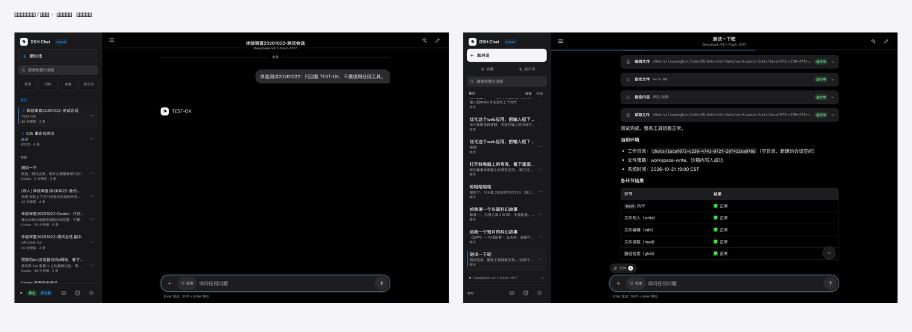
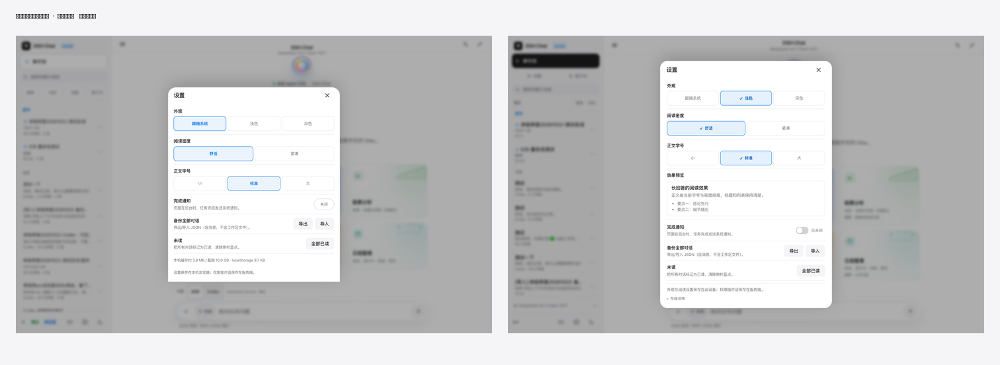
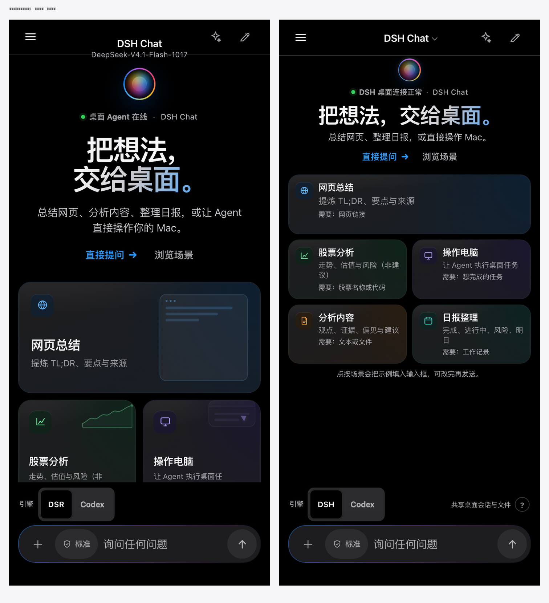
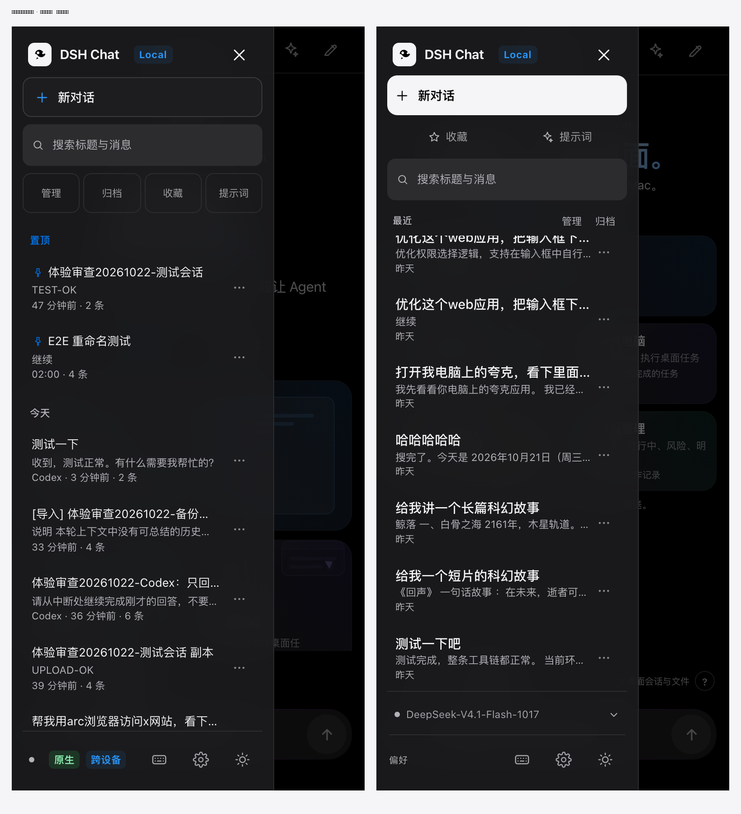
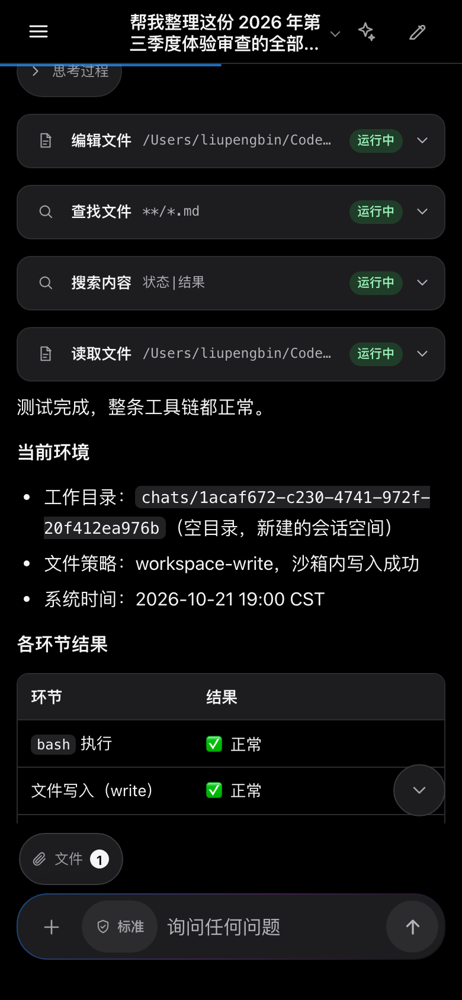
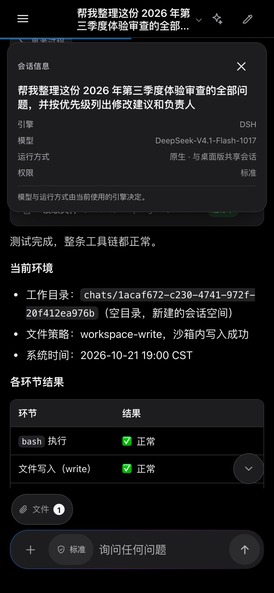

# DSH Chat 设计审查第二轮：修正记录

日期：2026-10-22
范围：页面设计、信息层级、阅读体验与响应式布局（对应审查报告 20 项建议）

本轮保留审查确认有效的正文栅格：桌面消息正文仍为 760px，H2 与列表层级不变。改动集中在顶栏、首页、侧栏、设置和阅读细节。

## 一、先修正的布局问题

### 01 顶栏完整容纳标题和模型信息（P1）— 已修正

- 顶栏高度从 52px 调整为桌面 58px、手机 54px，标题区按两行实际高度垂直居中。
- 桌面保留「会话标题 + 模型」两行；手机只显示会话标题（最多两行），模型与运行方式进入详情。
- 顶栏标题区本身成为按钮（手机带小箭头提示），点按打开「会话信息」卡，显示完整标题、引擎、模型、运行方式与当前权限；长标题不再只能靠 tooltip。
- 验证：1440/768/390/360 四种宽度下，标题与副标题均落在顶栏内；390px 下 32 字长标题显示两行、name bottom 45.3 < 54，点按信息卡可读取完整标题。

### 02 桌面设置弹窗收住底部内容（P1）— 已修正

- 设置面板拆成：固定标题栏、可滚动 `.settings-body`、固定 `.settings-footwrap` 页脚。
- 桌面（≥720px）改为四角完整的居中面板（`border-radius: 22px`），不再是从窗口底部切齐的 bottom sheet。
- 面板使用 `max-height: min(84vh, 760px)` + `overflow: hidden`，主体独立滚动；页脚始终在面板内部。
- 验证：1440×900、1280×560 下 `footer.bottom <= panel.bottom`；短窗口主体 `scrollHeight 617 > clientHeight 339`，可滚动；关闭按钮始终位于面板内。

### 03 阅读进度线只服务于阅读区域（P2）— 已修正

- `.read-progress` 由 `position: fixed; left: 0` 改为 `.main` 内的绝对定位，起点跟随主区域。
- 颜色由蓝紫渐变改为单一品牌蓝，降低装饰性。
- 空首页、无当前会话或内容不足一屏时隐藏。
- 验证：桌面进度线 `left = 290 = main.left`，手机 `left = 0` 且不覆盖标题；空首页隐藏。

## 二、首页

### 04 手机首页缩短宣传区（P2）— 已修正

- 390px 下 orb 34px、单行短标题、一句说明、紧凑 CTA；场景卡改为横向布局。
- 390×844 实测：五张场景卡全部在输入框上方完整显示（最后一张 bottom 513 < composer top 754）；320×700 同样五张完整、无横向溢出。
- 桌面首页的编辑式大标题与 bento 主推关系保留。

### 05 场景卡用输入示例说明能力（P2）— 已修正

- 每张卡新增「需要：网页链接 / 股票名称或代码 / 想完成的任务 / 文本或文件 / 工作记录」。
- 场景区下方新增说明：「点按场景会把示例填入输入框，可改完再发送。」卡片 aria-label 同时说明“填入示例”。
- 手机端统一卡片尺寸与结构，不再让“网页总结”以面积暗示立即执行；桌面保留主推卡的视觉权重。

### 06 引擎、模型和在线状态形成解释体系（P2）— 已修正

- 引擎显示名由 `DSR` 改为 `DSH`（内部 id 仍为 `dsr`，兼容历史数据）。
- 引擎旁新增 `?`：说明 DSH 共享桌面会话与文件、Codex 使用独立工作区与模型，以及“在线”只代表与桌面版的连接。
- 引擎提示随选择变化：`共享桌面会话与文件` / `独立工作区与模型` / `Headless · 能力受限`；手机不再隐藏该提示。
- 首页状态改为「DSH 桌面连接正常 / Codex 桌面在线 / Headless 模式 · 部分能力不可用」，并附解释性 title。
- 底栏连接详情列出连接、引擎、运行方式、会话范围与完整模型。

### 07 空首页使用独立的滚动提示（P2）— 已修正

- “回到底部”只在存在当前会话且处于阅读态时显示；空首页、新对话页强制隐藏。
- 验证：390px 空首页 `scrollBottom.hidden = true`；进入长对话并从顶部向上滚动后按钮出现，点按后隐藏。

## 三、侧栏与搜索

### 08 新对话与管理动作拉开层级（P2）— 已修正

- “新对话”改为实心主按钮（44px 高），成为侧栏第一视觉入口。
- 收藏、提示词改为无边框轻量导航。
- 管理与归档移到列表上方的工具栏右侧，靠近它们作用的对象。
- 侧栏结构顺序：品牌 → 新对话 → 收藏/提示词 → 搜索 → 列表工具栏 → 列表 → 连接与偏好。

### 09 搜索框、计数、结果组成连续区域（P2）— 已修正

- 工具栏紧接搜索框：左侧「最近」，搜索时替换为「搜索结果 · N」，右侧管理/归档。
- 删除了列表内重复的“搜索结果”分组标题，只保留一处结果状态。
- 验证：搜索后 `groupLabels = []`，计数为「搜索结果 · 8」，搜索框到列表间不再隔着整排按钮。

### 10 搜索结果不要重复同一标题（P2）— 已修正

- 服务端不再把标题当作 snippet；标题命中只在标题内高亮。
- 正文命中才显示摘录，并加「正文」标记；摘录中的关键词继续高亮。
- 验证：标题命中行 `snippet` 为空、标题 mark 为 1；正文命中行显示“正文”徽标与高亮摘录。

### 11 会话标题成为列表的阅读主体（P2）— 已修正

- 标题 14.5px / 500；预览 11.5px；元信息 10.5px。
- 移除每行常驻的“N 条”字段，改为 meta 的 title；运行中仍显示“正在生成…”。
- 行内更多按钮缩至 30px，标题获得更多横向空间；长标题保留省略号与完整 title。

### 12 底栏区分状态信息和可点击操作（P2）— 已修正

- 底栏改为两段：可展开的连接状态行；带「偏好」标签的操作行（快捷键、设置、主题）。
- “原生 / 跨设备”等标签移入连接详情，不再与图标混排。
- 展开后显示连接、引擎、运行、会话范围、模型，并说明在线状态的范围。

## 四、对话阅读与视觉语言

### 13 思考过程用明确的折叠图标（P2）— 已修正

- 思考过程改为下/右方向箭头：收起为 `-90°`，展开为 `0°`；按钮补充“展开/收起思考过程”的 aria-label。
- 实时“正在思考…”改用脉冲圆点，不再与场景入口共用星光图标；场景入口继续使用 ✦。

### 14 长路径与标识符优化断行（P2）— 已修正

- Markdown 行内代码中的 `/`、`\` 后插入 `<wbr>`，路径优先在边界换行；其余长串使用 `overflow-wrap: anywhere`。
- 32 字符以上的技术值变为可聚焦、可点按复制的 `code.code-value`，带完整值 title；点按/Enter/Space 复制并提示“已复制完整值”。
- 行内代码底色减淡，代码块不受影响（选择器限定 `:not(pre) > code`）。

### 15 强调色建立稳定用途（P3）— 部分实施

- 阅读进度改为单一品牌蓝，选中态统一使用品牌蓝并附勾选标记。
- 搜索高亮（黄）、成功/在线（绿）、错误（红）保留为语义色。
- 首页 orb 与 hero 渐变作为品牌装饰保留；正文阅读页未新增装饰渐变。

## 五、设置

### 16 字号与密度增加即时预览（P2）— 已修正

- 设置内新增“效果预览”，包含标题、正文与两行列表；字号使用 `--reading-scale`，密度使用 `data-density`，选择后即时变化。
- 验证：标准字号预览 12.5px，选择“大”后 13.75px；紧凑密度下预览行高收紧。

### 17 通知状态使用清楚的开关形态（P2）— 已修正

- 改为轨道 + 圆形滑块 + 「已开启/已关闭」文字，保留 `role="switch"` 与 `aria-checked`。
- 关闭时轨道灰、滑块居左；开启时轨道品牌蓝、滑块右移 16px。
- 验证：强制开启后 `transform = translateX(16px)`，轨道为 `rgb(41,151,255)`。

### 18 合并设置范围说明，收起技术存储数据（P2）— 已修正

- 页脚只保留一句：“外观与阅读设置保存在此设备；权限随对话保存在服务端。”
- localStorage 占用移入「存储详情」`
`，默认收起。

### 19 暗色选中态提高辨识度（P2）— 已修正

- 选中态使用主题对应强调色，并增加勾选符号作为非颜色线索。
- 暗色选中文字改为 `#9fd0ff`；浅色改为 `#0059b3`。按合成后的背景计算，对比度分别约 6.0:1 与 5.8:1（12px、600 字重），高于 4.5:1。
- 边框、底色与未选中表面保持差异；不依赖颜色也能通过 ✓ 判断。

### 20 输入提示适应操作环境（P2）— 已修正

- 触控（`hover: none` + `pointer: coarse` 且未检测到实体键盘）显示「点按 ↑ 发送」。
- 检测到非触控来源的可打印按键后，恢复「Enter 发送 · Shift + Enter 换行」。
- 说明文字与实际发送行为一致；触控下只占一行短提示。

## 六、回归方法与结果

- 工具：`tools/qa/design-r2.mjs`，使用 headless Chrome 的 CDP，显式绕过 Service Worker 以避免旧缓存干扰；输出原始截图与 `metrics.json` 到 `reports/design-r2/after/`（`reports/` 默认不入库），定稿副本与前后对比见 `docs/design/round2/`。
- 覆盖：1440×900 桌面深浅色、390×844 手机、360×800、320×700、1280×560 短窗口；首页、长对话、搜索、侧栏、设置、连接详情、引擎说明、会话信息。
- 关键量测：
  - 顶栏：desktop title/sub 均在 58px 内；mobile name 在 54px 内。
  - 设置：桌面与短窗口页脚均在面板内；关闭按钮可见；主体可滚动。
  - 首页：390px 五张卡片完整位于输入框上方；无横向溢出；空首页无回底按钮。
  - 搜索：唯一结果计数、无重复分组标题、标题/正文命中分流。
  - 代码：`chats/<uuid>` 含 1 个 `<wbr>`；360px 下不横向溢出。

## 七、未覆盖与后续

- 未在真实 iPhone/Android 上验证软键盘、安全区、触控手势与焦点移动；本轮为响应式视口测试。
- 未对文件、提示词等全部弹层做逐项复测；设置与新增信息卡为重点验证对象。
- 未做完整 VoiceOver 流程；焦点陷阱沿用既有的 `lockShell` + 弹层逻辑（既有 a11y 探针：对比度失败 0，场景弹层焦点保持在内）。
- 暗色/浅色选中态为本轮实际合成色计算；整站仍建议补一次自动化对比度扫描（`tools/qa/a11y.mjs` 可继续扩展）。

## 八、定稿截图

桌面对话（左：修改前；右：修改后）：

浅色桌面设置（左：修改前；右：修改后）：

手机首页（左：修改前；右：修改后）：

手机侧栏（左：修改前；右：修改后）：

手机长标题：两行内截断，点按可看完整标题与模型。

定稿原始截图：`docs/design/round2/desktop-conversation.png`、`desktop-settings-light.png`、`desktop-settings-dark.png`、`desktop-search.png`、`mobile-home-dark.png`、`mobile-sidebar-dark.png`、`mobile-settings-dark.png`、`mobile-conversation.png`、`mobile-long-title.png`、`mobile-long-title-info.png`、`desktop-settings-short-window.png`、`desktop-sidebar-status.png`、`mobile-chat-info.png`；量测明细见 `docs/design/round2/metrics.json`。
